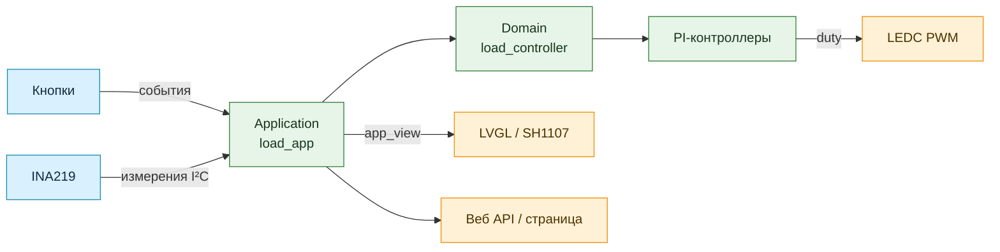

<div align="center">

# ⚡ Электронная нагрузка на ESP32-C3

Измеряйте напряжение, ток и мощность, управляйте нагрузкой в четырёх режимах
и наблюдайте данные на OLED-дисплее или веб-странице.

[](https://www.espressif.com/en/products/socs/esp32-c3)
[](https://github.com/espressif/esp-idf)
[](https://github.com/Lendlav/esp32_electronic_load/actions/workflows/build.yml)
[](https://www.freertos.org/)
[](https://lvgl.io/)
[](LICENSE)

</div>

---

## ✨ Возможности

| | Возможность | Детали |
|---|---|---|
| 🎛️ | Режимы нагрузки | **CC**, **CV**, **CP**, **CR** |
| 📟 | Локальный интерфейс | OLED SH1107, 128 × 64, кнопочное меню |
| 📈 | Веб-мониторинг | WPA2 точка доступа, график мощности, напряжения или тока |
| ⚙️ | Настройка | Шунт, частота PWM, диапазон INA219 и коэффициенты PI |
| 💾 | Сохранение | Настройки сохраняются в NVS |
| 🧱 | Архитектура | Domain и application отделены от ESP-IDF и драйверов |

## 🔌 Режимы работы

| Режим | Что поддерживает | Уставка |
|:---:|---|---:|
|  | Постоянный ток | A |
|  | Постоянное напряжение | V |
|  | Постоянная мощность | W |
|  | Постоянное сопротивление | Ω |

Режимы рассчитывают целевой ток, который ограничивается общими пределами,
а PI-регулятор тока формирует команду PWM. В CV дополнительный PI-контур
напряжения формирует целевой ток для основного контура.

## 🧭 Архитектура



- `main/domain/` — режимы, пределы и PI-алгоритм без зависимостей от ESP-IDF.
- `main/application/` — сценарий приложения, настройки и обработка событий.
- `main/adapters/` — INA219, PWM, кнопки, NVS, дисплей и веб-сервер.
- `main/platform/board_config.h` — GPIO, адреса периферии и параметры точки доступа.
- `components/esp_lcd_sh1107/` — драйвер OLED SH1107.

Подробное объяснение находится в [`SOURCE_GUIDE.md`](SOURCE_GUIDE.md) и
[`PROJECT_CONTEXT_AND_USER_MANUAL.txt`](PROJECT_CONTEXT_AND_USER_MANUAL.txt).

## 🕹️ Управление и настройки

| Кнопка | Действие |
|---|---|
| **UP / DOWN** | Перемещение по меню; изменение уставки или выбор редактируемого разряда |
| **SELECT** | Выбор режима, редактирование уставки, включение нагрузки |
| **BACK** | Немедленно выключить нагрузку |
| **BACK при включении** | Открыть меню настроек |

В меню настроек доступны сопротивление шунта, частота PWM, PGA-диапазон INA219,
а также IKP/IKI и VKP/VKI. Изменения записываются в NVS после выхода из меню.
Начальные коэффициенты PI — Kp **0.300**, Ki **0.200** для обоих контуров.

## 📡 Веб-мониторинг

Подключитесь к точке доступа **ElectronicLoad** с паролем **load8264** и откройте
[`http://192.168.4.1/`](http://192.168.4.1/). Страница показывает режим и уставку,
измерения, PWM и график выбранной величины. Интервал графика выбирается от 1 до
10 секунд; опрос страницы выполняется раз в секунду. Данные API доступны по
`/api/status`.

Параметры сети задаются в `main/platform/board_config.h`. Перед развёртыванием
смените пароль точки доступа на собственный.

## 🧩 Подключения по умолчанию

| Сигнал | ESP32-C3 | Подключение |
|---|---:|---|
| I²C SDA / SCL | GPIO 8 / 9 | OLED SH1107 и INA219 |
| PWM | GPIO 10 | Вход драйвера затвора MOSFET |
| UP / DOWN | GPIO 1 / 2 | Кнопки на GND |
| SELECT / BACK | GPIO 3 / 4 | Кнопки на GND |
| OLED / INA219 | 0x3C / 0x40 | I²C адреса по умолчанию |

Проверьте распиновку и адреса конкретных модулей до подключения силовой части.

## ⚠️ Пределы и безопасность

> [!CAUTION]
> Программные пределы — **30 V, 120 A и 2000 W** — не являются подтверждением,
> что собранная силовая схема безопасно выдерживает такую нагрузку. Сам INA219
> рассчитан на общую точку до **26 V**. Не превышайте допустимые напряжение,
> ток и рассеиваемую мощность шунта, MOSFET и охлаждения.

> [!IMPORTANT]
> Перед включением задайте сопротивление фактически установленного шунта.
> При настройке, не совпадающей с реальным шунтом, измерение тока будет
> ошибочным, а регулятор может раскачиваться. Сначала проверяйте устройство
> от источника с ограничением тока, при низком напряжении и небольшой нагрузке.

Прошивка не заменяет предохранитель, аппаратное ограничение тока и температуры,
подходящий драйвер затвора и правильно рассчитанный теплоотвод.

## 🛠️ Сборка и прошивка

Нужен **ESP-IDF 5.3** с поддержкой ESP32-C3. Из корня проекта в настроенном
терминале ESP-IDF выполните:

```bash
idf.py -B build -DIDF_TARGET=esp32c3 build
idf.py -B build -p PORT flash
```

Замените `PORT` на порт платы, например `/dev/ttyACM0` или `COM5`.
После загрузки нагрузка остаётся выключенной.

📦 **Готовый комплект прошивки** собран 14 октября 2026 года:
[`firmware/release_2026-10-14`](firmware/release_2026-10-14/)
· [инструкция записи](FIRMWARE_FLASH_GUIDE.md).

> [!NOTE]
> Комплект от 14 октября — сохранённый выпуск и может не содержать более поздние
> изменения исходников. Чтобы получить прошивку из текущей версии, соберите её
> командой выше.

## 📚 Документация

- [Полный контекст и руководство пользователя](PROJECT_CONTEXT_AND_USER_MANUAL.txt)
- [Карта исходников и архитектурные заметки](SOURCE_GUIDE.md)
- [TODO и известные ограничения](TODO.md)
- [Гайд прошивки на Linux и Windows](FIRMWARE_FLASH_GUIDE.md)

---

<div align="center">

**ESP32-C3 · ESP-IDF · INA219 · LVGL · FreeRTOS**

</div>
